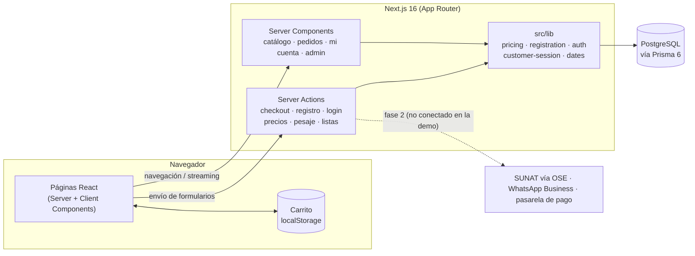
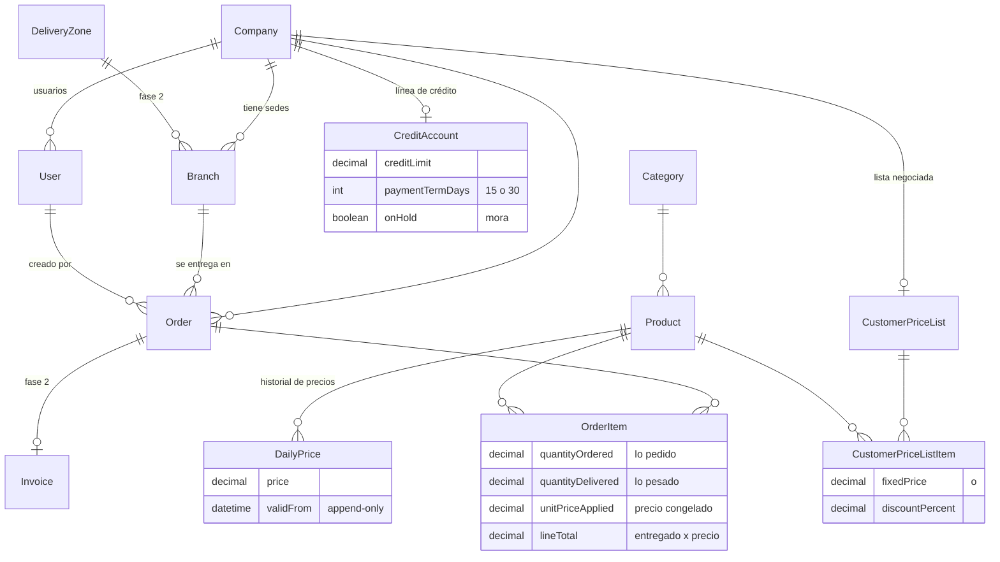
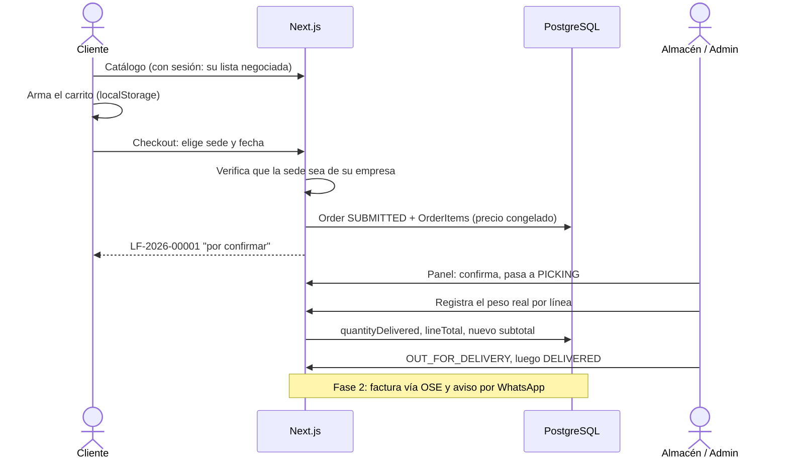

# LazoFood: informe técnico

Arquitectura, modelo de datos, decisiones de diseño y límites conocidos.
Para instalar y probar la demo, ver el [README](../README.md).

## 1. Contexto y problema

LazoFood abastecía verduras, frutas y tubérculos a pollerías y restaurantes
de Lima. El comprador es una **empresa** y no una persona, y eso cambia
casi todo frente a un ecommerce al consumidor:

| Ecommerce típico | Este rubro (B2B de perecibles) |
|---|---|
| Precio fijo en catálogo | El precio cambia **cada día** según el mercado mayorista |
| Mismo precio para todos | Cada empresa negocia **su propia lista** (descuento o precio fijo) |
| Se cobra lo que se pidió | Se cobra lo que **se pesó al despachar**; 20 kg pedidos pueden ser 18.6 kg entregados |
| Pago con tarjeta al comprar | Pago **contra factura a 15/30 días**, con línea de crédito y bloqueo por mora |
| Envío a una dirección | Una cadena tiene **varias sedes**, cada una con su ventana de entrega |

Estas cinco diferencias explican casi todo el modelo de datos.

## 2. Arquitectura



- **Sin API REST propia.** Las lecturas se hacen en Server Components y las
  escrituras en Server Actions. Toda la lógica de negocio vive en el
  servidor, junto a la base de datos.
- **Cache Components + Partial Prerendering** (`cacheComponents: true`): el
  esqueleto de cada página se sirve estático y lo que depende de la sesión
  o de la base (catálogo, pedidos, cuenta) llega por streaming dentro de
  `<Suspense>`.
- **El carrito vive en el navegador** (`localStorage`, leído con
  `useSyncExternalStore`). No necesita cuenta para armarse y no ocupa la
  base hasta que se confirma el pedido.

### Estructura del código

```
src/
  app/
    page.tsx                 Landing
    catalogo/                Catálogo con precio del día o lista negociada
    carrito/  checkout/      Carrito y confirmación (invitado o con sesión)
    pedido/[orderNumber]/    Confirmación / detalle público del pedido
    registro/                Alta de empresa + sede + usuario dueño
    login/                   Login único (equipo interno y clientes)
    mi-cuenta/               Pedidos, sedes y crédito del cliente
    admin/                   Panel interno (requiere rol de staff)
      precios/               Precio del día (append-only)
      pedidos/               Estados y pesaje real al despacho
      clientes/              Listas de precios negociadas
  components/                UI compartida (carrito, formularios, admin)
  lib/
    pricing.ts               Resolución de precio (fijo > % desc. > precio del día)
    registration.ts          Transacción de registro (testeable sin Next)
    auth.ts                  Hash de contraseñas, sesiones, requireStaff()
    customer-session.ts      Sesión de cliente con empresa y sedes
    dates.ts                 Formato de fechas de calendario (UTC)
prisma/
  schema.prisma              Modelo de datos con comentarios de diseño
  seed.ts  data/products.ts  120 productos, empresa demo, cuentas demo
tests/integration/           Tests contra Postgres real
```

## 3. Modelo de datos



### Decisiones clave

1. **`DailyPrice` es append-only.** Cambiar un precio inserta una fila
   nueva y nunca modifica la anterior. Así se puede responder cuánto
   costaba el limón el 3 de octubre, que es lo que se necesita para
   reportes de margen y para defender una factura ante un reclamo.
2. **Precio congelado en el pedido.** `OrderItem.unitPriceApplied` guarda
   el precio ya resuelto al confirmar. Si mañana cambia el precio del día,
   los pedidos de ayer no cambian.
3. **Lo pedido y lo entregado van en columnas separadas.** El subtotal se
   recalcula sobre `quantityDelivered` cuando almacén registra el peso real
   (ver captura 12: 257.20 pedidos, 254.62 entregados).
4. **Todo monto y peso usa `Decimal`**, nunca `Float`. En punto flotante,
   `0.1 + 0.2 ≠ 0.3`, y en una factura eso no es aceptable.
5. **Prioridad de precio**, en `src/lib/pricing.ts`: precio fijo pactado,
   luego % de descuento sobre el precio del día, luego precio del día.
6. **Cadena = Company con varias Branch.** Se pide por sede, y el crédito y
   la factura se consolidan a nivel empresa.

## 4. Flujo de un pedido



Estados: `SUBMITTED → CONFIRMED → PICKING → OUT_FOR_DELIVERY → DELIVERED →
INVOICED`, más `CANCELLED`.

## 5. Autenticación y seguridad

- **Contraseñas** con bcrypt y **sesiones opacas** en base de datos: un
  token aleatorio de 32 bytes en una cookie `httpOnly` + `sameSite=lax`,
  que vence a los 7 días. No se usan JWT, para poder revocar una sesión
  con solo borrarla.
- **Login único y roles.** `ADMIN/SALES/WAREHOUSE/DRIVER` van al panel y
  `CUSTOMER_OWNER/CUSTOMER_STAFF` a "Mi cuenta". El layout de `/admin`
  redirige a cualquier otro rol.
- **Las Server Actions son endpoints públicos.** Proteger la página no
  protege la acción, así que cada acción del panel llama a
  `requireStaff()`. Antes de esta versión no lo hacían: cualquiera podía
  cambiar precios con un POST.
- **El servidor no confía en el formulario.** En el checkout con sesión se
  verifica que la `branchId` enviada pertenezca a la empresa del usuario,
  y un invitado no puede pedir con el RUC o el teléfono de una cuenta
  existente, porque podría sobrescribir sus datos.
- **Validación con Zod** en el borde de cada Server Action.

## 6. Tests

| Tipo | Qué cubre |
|---|---|
| Unitarios (`src/**/*.test.ts`) | Resolución de precio, hashing, formato de fechas |
| Integración (`tests/integration`) | Contra Postgres real: precio del día append-only, subtotal sobre lo entregado, listas negociadas, registro (incluido reclamar una empresa de invitado), y el **Server Action real de checkout** con `cookies()`/`redirect()` simulados: sede propia, sede ajena rechazada, RUC con cuenta rechazado |

`npm test` corre las 26 pruebas en unos 2 segundos.

## 7. Bugs que encontraron las pruebas

Dos ejemplos de por qué conviene probar de punta a punta y no solo
compilar:

- **La fecha de entrega aparecía un día antes.** Un pedido para el 10 de
  octubre se mostraba como "09 de octubre". `requestedDate` es una columna
  `DATE`: Prisma la devuelve como medianoche UTC, y al formatearla en hora
  de Lima (UTC-5) cae en el día anterior. Ahora las fechas de calendario
  se formatean en UTC (`src/lib/dates.ts`), con un test que lo cubre.
- **Recargar `/checkout` mandaba al carrito aunque tuviera productos.** En
  el primer render, el de hidratación, el carrito todavía está vacío
  porque aún no se leyó `localStorage`, y la página lo tomaba como vacío
  de verdad. `useCart()` ahora expone `ready` para distinguir ambos casos.

## 8. Límites conocidos (es una demo)

- **El precio unitario lo envía el navegador** en el carrito, y el servidor
  no lo vuelve a resolver al confirmar. En producción, `submitOrder`
  debería recalcular cada línea con `resolvePrice`.
- **El formulario "Ingresa tu RUC" del catálogo** muestra la lista
  negociada de cualquier empresa a quien conozca su RUC. Con cuentas, eso
  debería exigir sesión.
- Sin recuperación de contraseña ni verificación de correo.
- La numeración `LF-AAAA-NNNNN` usa `count()+1`: dos pedidos simultáneos
  pueden chocar (la restricción `@unique` lo impide, pero uno falla). Lo
  correcto sería una secuencia de Postgres.
- Los tests de integración corren contra la base de desarrollo, no una
  descartable.
- Fase 2 sin implementar: crédito con bloqueo automático, rutas por zona,
  facturación electrónica y WhatsApp.
